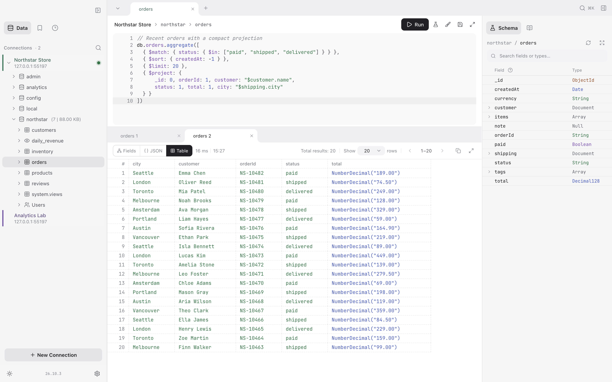
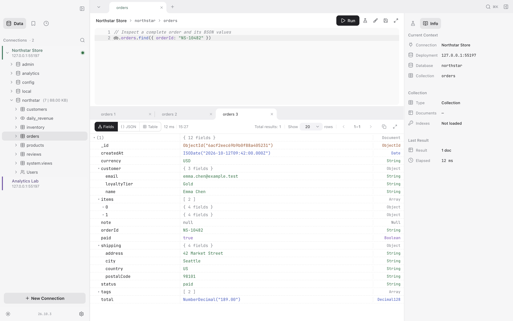
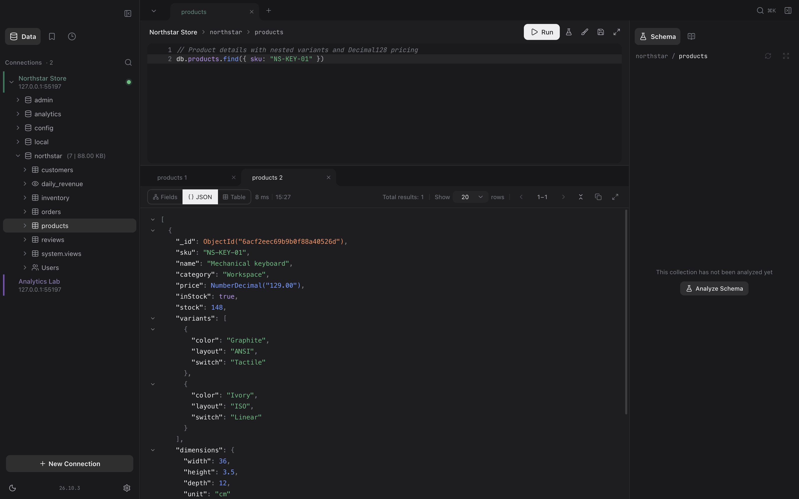
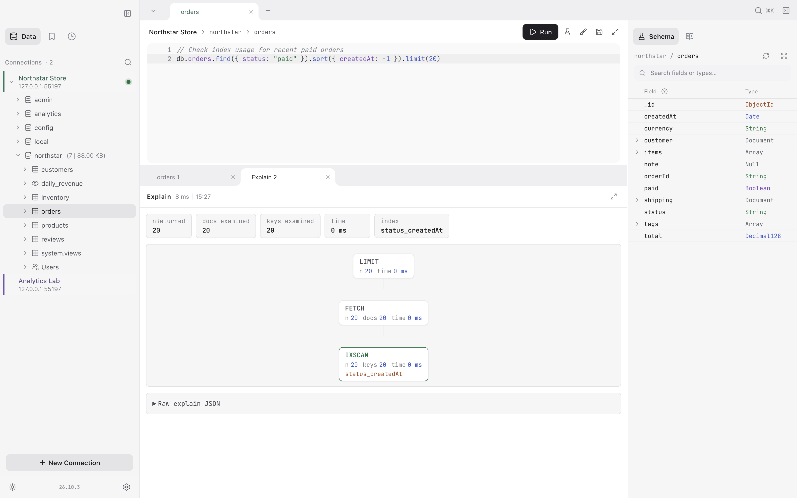

# AMDM (Another Mongo Desktop Manager)

[English](./README.md) | [中文](./README_CN.md)

一个精简、性能优先的 MongoDB 桌面 GUI，Electron 驱动



<details>
<summary>更多截图：文档树、深色主题与可视化 Explain</summary>

**文档树**



**深色主题**



**可视化 Explain**



</details>

## 运行

```bash
pnpm install                         # 安装依赖
pnpm dev                             # 启动应用并热重载
pnpm typecheck                       # 检查主进程与渲染进程类型
pnpm test:unit                       # 运行单元与契约测试
pnpm build                           # 生产构建到 ./out
pnpm dist:dir --mac --arm64          # 打包未安装的 Apple Silicon 应用
pnpm install:mac                     # 打包、替换 /Applications/AMDM.app 并启动
pnpm clean                           # 清理构建产物
```

## 功能

- 浏览数据库 / 集合 / 索引 / 用户
- 数据内联编辑，多标签页查看
- `vm` 沙箱 Shell，运行 mongosh 风格的 JS（`find` / `aggregate` / `runCommand` …）
- 支持自动补全，保存常用查询、查看历史
- 原生导入 / 导出 JSON / CSV / XLSX / BSON
- 连接备份、MongoDB URL 列表及其他客户端的连接格式适配
- Tree / JSON / Table 结果视图
- 可视化 explain
- 支持内网浏览器访问的 [Web 版本](docs/WEB.md)

桌面版可右键 Connections 标题或空白处导入／导出连接，也可右键某个连接单独导出。
支持 AMDM 备份、纯 URL 列表、Compass JSON、Studio 3T URI 文件、NoSQLBooster URI
列表，以及供 Robo 3T 粘贴使用的 URL。默认不包含密码；AMDM 备份可整体加密。
SSH 私钥和 TLS 证书仅保留路径，文件需另外迁移；标准 URL 不包含 SSH 隧道、连接名称和颜色。

## macOS 安装

Apple Silicon（arm64）和 Intel（x64）均需要 macOS 13 Ventura 或更高版本。

macOS 版本通过 Sparkle 更新,使用 ad-hoc 签名且未经 Apple 公证。首次打开时请在“隐私与安全性”中点击“仍要打开”,或执行 `xattr -dr com.apple.quarantine /Applications/AMDM.app`。

## 许可证

[GNU GPL v3.0](./LICENSE)
